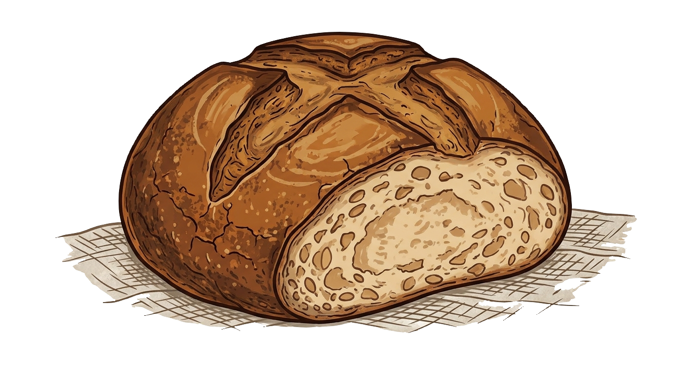
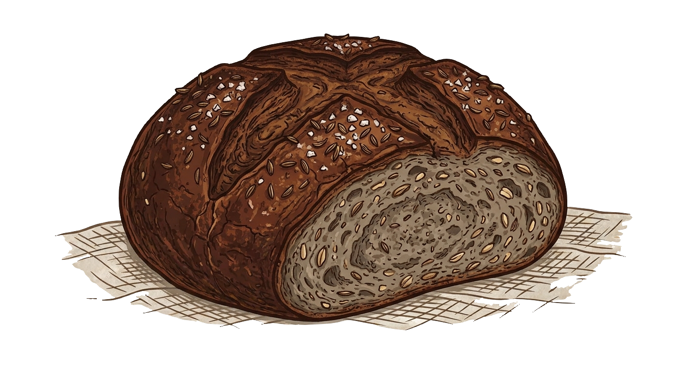
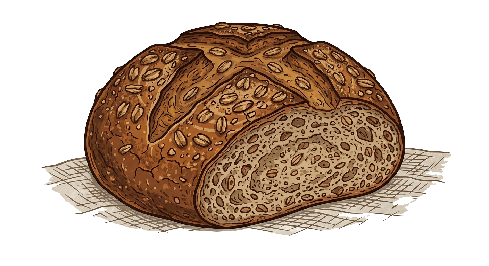
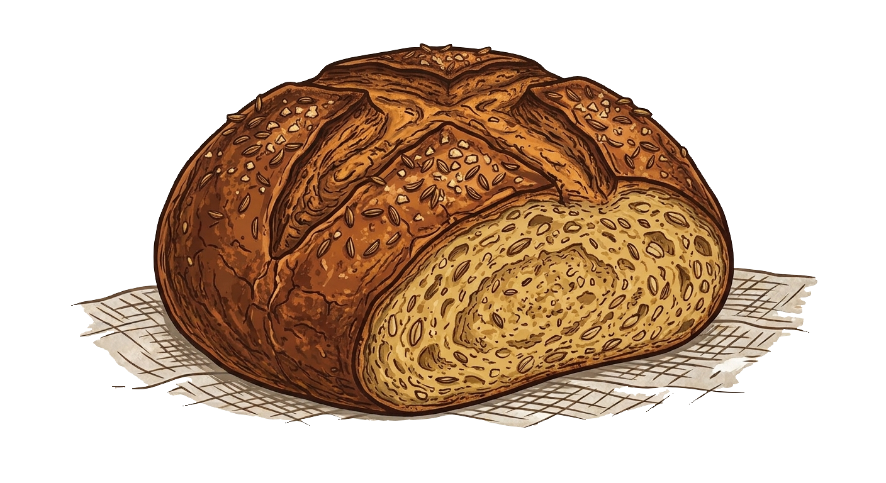
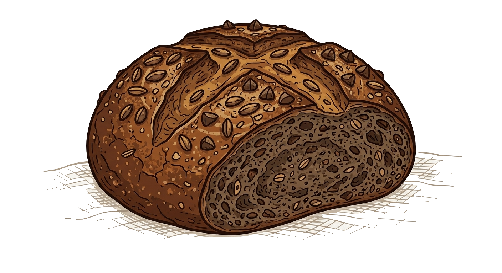
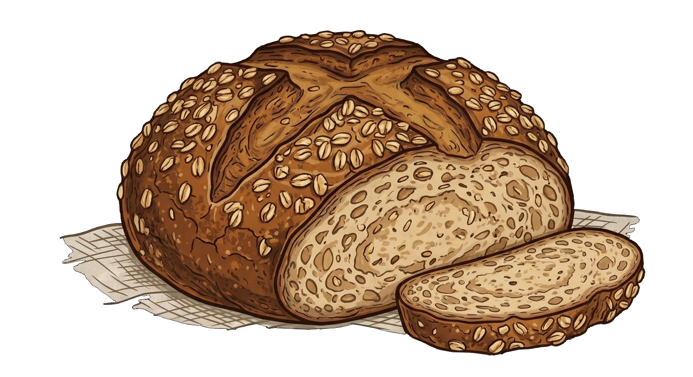
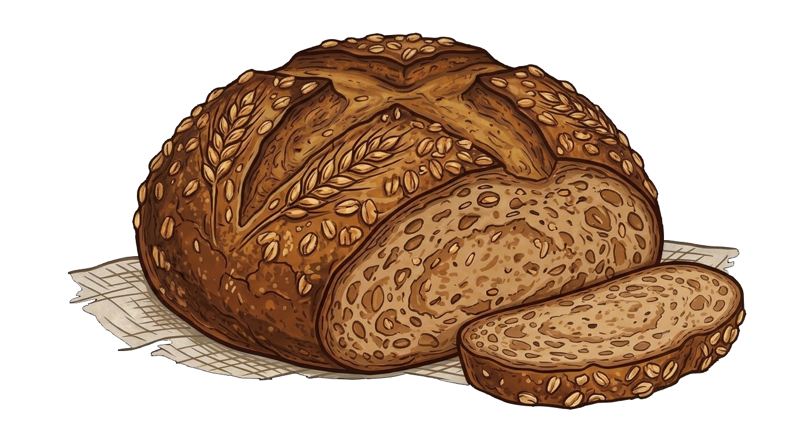

## Taula de continguts

# Blat *(wheat, trigo)*

És el cereal panificable més popular i utilitzat a tot el món pel seu alt contingut de gluten (gliadina i glutenina), que aporta una gran elasticitat i esponjositat a les masses. Els cereals antics com l'espelta o el kamut són varietats botàniques d'aquest mateix gènere (*Triticum*).

Aporta principalment:
- **Hidrats de carboni:** La seva font d'energia principal.
- **Proteïnes:** Més elevades que en el sègol, ideals per al rendiment esportiu i l'estructura del pa.
- **Fibra i fitoquímics:** Concentrats en el salvat i el germen del gra integral.
- **Vitamines destacades:** Supera el sègol en vitamina B1 (tiamina), essencial per a l'energia, i en B3 (niacina) i B6 (piridoxina), claus per al sistema nerviós i el metabolisme.
- **Minerals:** Aporta calci, ferro, fòsfor, magnesi, zinc i seleni.

# Sègol *(rye, centeno)*

És una espècie botànica totalment independent del blat. 

Comparat amb el blat, destaca per:
- **Panificació:** Té menys gluten, fet que dona lloc a pans més foscos, compactes, menys esponjosos, però que es conserven tous durant més temps. Té un gust més fort i amarg.
- **Fibra i sacietat:** Duplica la quantitat de fibra del blat, millorant el trànsit intestinal i la microbiota.
- **Índex glucèmic:** Té un índex glucèmic molt inferior al del blat, evitant pics de sucre a la sang. Tria sègol per controlar el pes o regular la glucosa.
- **Greixos saludables:** Té menys greix total que el blat, pero una millor ràtio d'omega-3.
- **Vitamines:** Duplica la vitamina E (antioxidant) del blat i el supera notablement en vitamina K (coagulació i ossos). També aporta més vitamina B2, B5 i B9 (àcid fòlic).
- **Minerals:** Té una major concentració de ferro, potassi i magnesi que el blat.

# Espelta *(spelt)*

És una varietat antiga de blat, considerada el seu avantpassat directe, per la qual cosa sí que conté gluten.

Comparada amb el blat comú, destaca per:
- **Cultiu natural:** Té una closca dura que la protegeix de plagues i de la contaminació, requereix menys pesticides i se sol comercialitzar en format integral.
- **Digestibilitat:** Tot i tenir gluten, la seva estructura molecular es desfà més fàcilment a l'estómac, resultant més fàcil de digerir que el blat modern.
- **Proteïna de major qualitat:** Aporta un perfil d'aminoàcids superior al del blat, incloent-hi 8 dels 9 aminoàcids essencials (una proteïna gairebé completa).
- **Nutrients totals:** Té una concentració lleugerament superior de fibra, vitamines i minerals que el blat comú.

# Kamut *(khorasan wheat)*

És el nom comercial d'una varietat antiga de blat dur (el blat Khorasan) i conté gluten.

Comparat amb el blat comú, destaca per:
- **Densitat nutricional:** Al contrari que el blat modern, conté menys aigua i fins a un 30% més de proteïnes. També el supera en àcids grassos, vitamines i minerals.
- **Qualitat proteica:** Igual que l'espelta, supera el blat comú en aportar 8 dels 9 aminoàcids essencials.
- **Panificació:** Al tenir un gluten diferent i menys aigua, dona pans menys esponjosos però molt més densos i amb un característic gust dolç (com de nou).
- **Sostenibilitat:** Com que la marca registrada s'importa i es produeix principalment a Amèrica del Nord sota criteris estrictes, és un producte més car i amb una petjada de carboni superior a la del blat local.

# Fajol *(buckwheat, trigo sarraceno)*

Malgrat el seu nom en castellà ("trigo sarraceno"), no és una varietat de blat ni tan sols un cereal; és un **pseudocereal** de la família del ruibarbre.

Comparat amb el blat, destaca per:
- **Sense gluten:** És 100% lliure de gluten de manera natural, ideal per a celíacs. Les seves masses no són gens esponjoses i requereixen tècniques diferents de panificació.
- **Digestió:** És molt més fàcil de digerir que qualsevol varietat de blat.
- **Perfil de greixos:** Supera clarament el blat en la quantitat de greixos saludables, sent molt ric en àcids grassos essencials omega-3 i omega-6 (incloent-hi l'àcid linoleic).
- **Proteïnes i micronutrients:** Té un valor proteic més alt i una concentració de minerals (com el magnesi i el coure) i vitamines superior a la del blat.
- **Preu:** En no ser un cultiu massiu com el blat, el seu cost al mercat és força més elevat.

# Civada *(oats, avena)*

És un cereal d'una línia botànica diferent del blat. Tot i que de manera natural no conté gluten, sovint pateix contaminació creuada als molins on es processa blat.

Comparada amb el blat, destaca per:
- **Fibra soluble (Beta-glucans):** És la seva gran arma. Conté un tipus de fibra que forma un gel a l'estómac, ideal per reduir el colesterol LDL i regular el sucre. El blat té més fibra insoluble (salvat).
- **Greixos saludables:** Té gairebé el triple de greix que el blat, destacant per un contingut molt alt d'àcid linoleic (omega-6) i greixos monoinsaturats.
- **Panificació:** No té les proteïnes formadores de gluten del blat. Per fer pa, s'ha de barrejar amb blat o utilitzar additius naturals (com el psyllium) perquè no quedi un bloc trencadís.
- **Preu:** Molt econòmica en format de flocs, tot i que la farina certificada "sense gluten" és més cara que la de blat.

# Ordi *(barley, cebada)*

És un dels cereals cultivats més antics, de la mateixa família que el blat però d'un gènere diferent. Conté gluten, però en una quantitat molt menor.

Comparat amb el blat, destaca per:
- **Estructura i textura:** S'utilitza menys per a pans inflats i més per a pans plans, barrejada amb altres farines, o directament el gra sencer en guisats i sopes (ordi perlat).
- **Riquesa en minerals:** Supera el blat en minerals clau com el potassi, el fòsfor i el magnesi, i té una aportació antioxidant molt potent.
- **Efecte saciant:** Gràcies a la combinació de fibra soluble i insoluble, manté la sacietat durant més temps que el blat comú.
- **Sostenibilitat i preu:** És un cultiu molt resistent que requereix poca aigua. La farina és assequible, tot i que no és tan fàcil de trobar als supermercats convencionals com la de blat o sègol.

---

# Taula resum

| Cereal / Pseudocereal | Té Gluten? | Tipus de Pa | Preu Estimat (Farina integral per kg) | Disponibilitat |
| :--- | :--- | :--- | :--- | :--- |
| **Blat Comú** | **Sí** | Molt esponjós, elàstic i lleuger. | Econòmic (1,20 € - 1,80 €) | **Màxima** (Tots els supers i fleques). |
| **Sègol** | Sí (poc) | Dens, fosc, compacte i durador. | Assequible (2,00 € - 3,00 €) | **Alta** (Supers grans, herbolaris, fleques artesanals). |
| **Espelta** | Sí | Similar al blat, una mica més fràgil. | Mitjà (2,50 € - 4,00 €) | **Alta** (Supers habituals, secció bio/integral). |
| **Kamut** | Sí | Dens, sabor dolç i color daurat. | Car (4,50 € - 6,00 €) | **Baixa/Mitjana** (Botigues eco, herbolaris o fleques especialitzades). |
| **Fajol** | **No** | Molt dens, s'esquerda fàcilment. | Car (4,00 € - 6,50 €) | **Mitjana** (Herbolaris, dietètiques, supermercats bio). |
| **Civada** | No (però s'ha de certificar) | Humit, pesat (requereix barreges). | Econòmic/Mitjà (2,00 € - 3,50 €) | **Alta** (Farina i flocs a qualsevol supermercat). |
| **Ordi** | Sí (poc) | Pa pla, rústic o dens. | Mitjà (2,50 € - 3,50 €) | **Baixa** (Herbolaris, botigues de gra a granel, supermercats bio). |

# Recomanacions generals

- Consumir cereals integrals es més important que el cereal escollit.
- Si no patim al·lèrgies ni intoleràncies no hi ha cap benefici en suprimir el pa de la dieta.
- La varietat de cereals (i de la dieta en general) es més important que les modes.

# Referències

- [El Mundo - La trola de los cereales 'cuquis'](https://www.elmundo.es/papel/boticaria-garcia/2020/03/07/5e611b72fc6c83de468b45b6.html)

- [National Center for Biotechnology Information - The contribution of wheat to human diet and health](https://www.ncbi.nlm.nih.gov/pmc/articles/PMC4998136/)

- https://nutritionsource.hsph.harvard.edu/what-should-you-eat/whole-grains/
